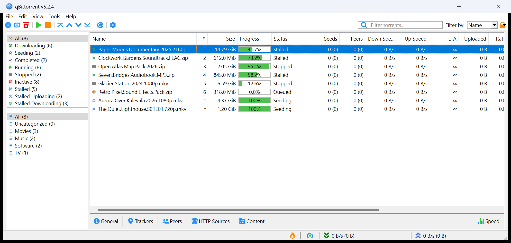

# qBittorrent → µTorrent 1.8.2 look

A UI theme for the **qBittorrent 5.x desktop app** (Windows) that makes it look like the classic µTorrent 1.8.2:
light Win32 look, compact menu and toolbar, thin "Done" progress bars, black list text, solid blue selection,
a category panel without section captions, and µTorrent's column order. qBittorrent's own icons are kept.

Tested with qBittorrent 5.2.4 x64 on Windows 11.



*Demo profile; all torrent names are fictional.*

## What is in here

| File | What it does |
| --- | --- |
| `config.json` | Light palette and colors (black list text, pieces bar, progress bar) |
| `stylesheet.qss` | Compact menu/toolbar/rows, thin progress bars, tab strip, captionless filter panel |
| `tools/apply-settings.js` | Sets the qBittorrent options the theme depends on, including the column order |

## Install

1. Clone or download this repository somewhere permanent, e.g. `%APPDATA%\qBittorrent\themes\utorrent182`.
2. **Close qBittorrent** (it rewrites its settings on exit).
3. Run (needs [Node.js](https://nodejs.org)):

   ```bat
   node tools\apply-settings.js
   ```

   It backs up `%APPDATA%\qBittorrent\qBittorrent.ini` next to it, then sets:

   - Options → Behavior: style `windowsvista`, color scheme `Light`, custom UI theme = this folder's `config.json`
   - no alternating row colors
   - "Auto hide zero status filters" on; Tags / Trackers groups collapsed
   - transfer list columns in µTorrent order: Name, #, Size, Done, Status, Seeds, Peers, Down Speed, Up Speed,
     ETA, Uploaded, Ratio, Avail., Label (Category), Added On, Completed On

   If you prefer to do it by hand, set the theme and style in Options → Behavior and arrange the columns yourself.
4. Start qBittorrent.

To undo: in Options → Behavior untick "Use custom UI Theme" and pick your old style, or restore the `.bak-*` ini copy.

## Automated install (for scripts / AI agents)

Exact steps in PowerShell. Stop and ask the user if a check fails.

1. **Requirements.** Windows (the `windowsvista` style exists only there), Node.js 18+, qBittorrent **5.x**:

   ```powershell
   (Get-Item "C:\Program Files\qBittorrent\qbittorrent.exe").VersionInfo.ProductVersion   # expect v5.*
   node --version
   ```

2. **Clone to a permanent folder.** The settings store the absolute path to this folder's `config.json`;
   moving or deleting the folder later silently drops the theme.

   ```powershell
   git clone https://github.com/cyberbob61/qbt-utorrent182-theme "$env:APPDATA\qBittorrent\themes\utorrent182"
   ```

3. **Find the settings file.** Normally `%APPDATA%\qBittorrent\qBittorrent.ini`. A portable install keeps it in
   `profile\qBittorrent\config\qBittorrent.ini` next to `qbittorrent.exe`; a `--profile=<dir>` launch keeps it in
   `<dir>\qBittorrent\config\qBittorrent.ini`.

4. **Close qBittorrent gracefully** and wait until the process is gone. Do **not** use `taskkill /F` or
   `Stop-Process`: a forced kill skips saving torrent resume data. Either ask the user to use File → Exit, or, if the
   Web UI is enabled with localhost authentication bypass, call:

   ```powershell
   Invoke-RestMethod -Method Post http://localhost:8080/api/v2/app/shutdown    # port = Web UI port
   while (Get-Process qbittorrent -ErrorAction SilentlyContinue) { Start-Sleep 1 }
   ```

   A plain `taskkill /IM qbittorrent.exe` may only hide the window to the tray.

5. **Apply the settings** (pass the ini path if it is not the default one):

   ```powershell
   node "$env:APPDATA\qBittorrent\themes\utorrent182\tools\apply-settings.js" "$env:APPDATA\qBittorrent\qBittorrent.ini"
   ```

   Expected output, three lines:

   ```text
   updated <path to qBittorrent.ini>
   backup  <path to qBittorrent.ini>.bak-<timestamp>
   theme   <path to this folder>/config.json
   ```

   An extra line `no saved column layout yet ...` means qBittorrent has never saved its columns: start it once,
   exit it, and rerun this step. An error mentioning `round-trip mismatch` or `expected qBittorrent 5.x columns`
   means the column layout was left untouched; everything else was still applied.

6. **Start qBittorrent** (`Start-Process "C:\Program Files\qBittorrent\qbittorrent.exe"`) and **verify**:

   ```powershell
   Select-String -Path "$env:APPDATA\qBittorrent\qBittorrent.ini" -Pattern 'CustomUIThemePath|UseCustomUITheme|^Style=|ColorScheme'
   ```

   Expect `UseCustomUITheme=true`, the path to `config.json`, `Style=windowsvista`, `ColorScheme=Light`. In the
   window: white flat toolbar, thin green bars in the Progress column, no STATUS / CATEGORIES captions on the left.
   If file logging is on, `%LOCALAPPDATA%\qBittorrent\logs\qbittorrent.log` must not contain "UI Theme" warnings.

7. **Roll back** if needed: close qBittorrent gracefully (step 4) and copy the `qBittorrent.ini.bak-<timestamp>`
   from step 5 over `qBittorrent.ini`.

## Notes and limits

- List icons are set to 9 px in `stylesheet.qss`, which is 16 physical pixels at 175 % Windows scaling, the size
  µTorrent draws them. Use 16 px at 100 %, 12 px at 125 %, 11 px at 150 %.
- The torrent list row height cannot go below qBittorrent's built-in minimum; a theme cannot change it.
- Hiding the STATUS / CATEGORIES captions also hides the Tags and Trackers groups. To get them back, set
  `TagFilterState` / `trackerFilterState` to `true` under `[TransferListFilters]` in the ini.
- Window title, menu names (Edit/View/Tools), the Transfers/RSS tabs and the extra status filters
  (Running, Stalled, ...) are hard-coded in qBittorrent and stay as they are.
- The column layout is stored by qBittorrent in a binary Qt format; `apply-settings.js` refuses to touch it unless
  it can read and re-write it byte-for-byte.
